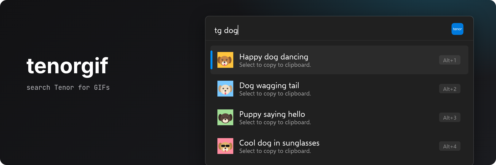

<!-- generated by readwright from docs/README.md.j2; edit the template, not this file -->


# TenorGIF

Search Tenor for GIFs from Flow Launcher.

[](https://github.com/Garulf/TenorGIF/actions/workflows/tests.yml) [](https://github.com/Garulf/TenorGIF/releases/latest) [](https://github.com/Garulf/TenorGIF/releases/latest)

[](https://www.buymeacoffee.com/garulf) [](https://github.com/sponsors/Garulf)

> [!WARNING]
> Google stopped accepting new Tenor API keys on January 13, 2026 and announced that the Tenor API
> would be shut down on June 30, 2026. See the
> [Tenor developer FAQ](https://support.google.com/tenor/answer/10455265?hl=en). Without a working
> key, searches show the error Tenor returns.

## Features

* **Search Tenor.** Results show a thumbnail of each GIF.
* **Copy or open.** `Enter` copies the GIF link or opens it in your browser, whichever you choose in settings.
* **Trending searches.** Type the keyword on its own to see what is trending, then pick a term to search it.
* **Context menu.** Open the GIF's Tenor page or copy its link, whatever the default action is.

## Usage

Type `tg` followed by what you are looking for:

```
tg dog
```


| Query | Result |
| --- | --- |
| `tg <search>` | GIFs matching the search |
| `tg` | Trending search terms. Select one to search it |

### Trending searches


### Context menu

Open the context menu (`Shift+Enter` or right-click) on a GIF to open its Tenor page or copy its link:


## Installation

### Flow Launcher

In Flow Launcher, type:

```
pm install tenorgif
```


### Manual installation

Download `TenorGIF-<version>.zip` from the [latest release](https://github.com/Garulf/TenorGIF/releases/latest) and unzip it into
`%appdata%\FlowLauncher\Plugins`, then restart Flow Launcher.

Pre-releases of the next version are published from the open release PR on the
[releases page](https://github.com/Garulf/TenorGIF/releases) for testing. Flow Launcher won't offer them as updates.

## Configuration

Open **Settings → Plugins → TenorGIF** in Flow Launcher:

| Setting | Default | Description |
| --- | --- | --- |
| Tenor API key | | Your Tenor API key |
| Max results | `10` | How many GIFs to show |
| Default action | `Copy to Clipboard` | What `Enter` does: copy the GIF link or open it in your browser |

## Requirements

* Flow Launcher 1.17.0 or newer
* Python 3.8 or newer, which Flow Launcher can install for you
* A Tenor API key

Powered by Tenor.

## Changelog

See [CHANGELOG.md](CHANGELOG.md) for the full history.
